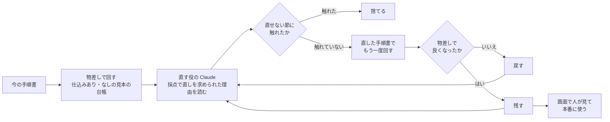

# 分析担当の改善（11/3 に作った）

DX 担当がいなくても、分析担当（Managed Agents の分析エージェント）の手順書（指示文 `agent/analyst_system.md`）が良くなっていく仕組み。
**答えの分かっている台帳で確かめながら直し、良くなった時だけ残す。本番に使うかは人が決める。**

> 11/3：本物で2回回し、第2回の版（「書く量」だけの直し）を人が画面で本番に使った（分析担当 版8）。その後、人がお知らせの記録を読む決まりを足して版9にした（docs/MAINTENANCE.md）。

## 流れ



1. **物差し**（`app/improve.py` の `evaluate`）：仕込みあり・なしの見本の台帳を作業用の場所に作り、手順書を差し替えたセッションを並べて回す。本番の台帳・本番のエージェントの版には触らない（セッションの `agent_with_overrides.system` で差し替える）
   - 数えるもの：報告の形が合うか・検算が一致したか・採点の何回目で合格したか・費用
   - 中身の確かめ（`agent/judge.md`・Sonnet 5.5）：仕込みありで「チラシが低く見えるのは先の日の予約が多いから」を見つけたか／仕込みなしで偶然かもしれない差を確かな差のように言い切らなかったか
2. **直す役**（`propose`・Opus 5.5）：今の手順書・採点で直しを求められた理由・物差しの結果・これまでの回（戻した理由）を読み、1〜3か所の直しを出す。店長向けの「ひとことで言うと」と、直す節ごとの「なぜ・報告で変わる見込み」も書く
3. **直せない節**（`LOCKED`）：「数え方」（アプリの数字と合わせる）・「言わないこと」（言い過ぎを防ぐ）・「出力」（報告の約束）。触れた案はコードで捨て、物差しにお金を使う前に止める
4. **残す・戻す**（`decide`）：直す役の言い分では決めない。報告の形が崩れた・検算がアプリの集計と合わない・中身の確かめに落ちた・採点に合格しなかった台帳がある、のどれかなら戻す。すべて満たした上で、採点の何回目で合格したかの合計（合格しなかった台帳は4と数える）が前の版より小さければ残す。同じなら、費用が1割以上減った時だけ残す。
   - ここで言う「良くなった」は、この2つの見本の台帳とこの決まりで良くなった、という意味に限る。ほかの台帳や本物の店で良くなったことまでは確かめていない（直す役はこの2つの台帳の結果を読むので、合わせ込める）
5. **次の回**：残した版から直す。戻した回の理由も直す役に渡す（同じ失敗をくり返さない）
6. **本番に使う**：画面「ナットクの改善」（`/improve`）で人が押す。手順書のファイルを書き換え、`scripts/setup_agent.py` と同じ手順でエージェントの版を上げる（失敗したらファイルも戻す）。手順書は git の差分として残るので、コミットするかも人が決める

## 直す役から変えられないもの

- 採点の基準（`agent/rubric.md`）・中身の確かめ（`agent/judge.md`）・残す／戻すの決まり（コード）
- 変えられると、採点を甘くして「良くなった」ことにできてしまうため

## 現場が分からないまま進まないように（画面の見せ方）

ボタンを押して決めるのは現場の人。手順書の話ではなく「届く報告がどう変わるか」と「押して大丈夫か」を先に見せる。

- **ひとことで言うと**・**残した理由／止めた理由**：言い直し役（`plain_explain`・Sonnet 5.5、断られたら Opus 5.5）が店長の言葉で書く
- **届く報告の前と後**：同じ見本の台帳で、前の版と直した版が実際に書いた報告から、変わった所をそのまま抜き出して並べる。抜き出した文が本当にその報告の欄にあるかはコードで確かめ、無ければ捨てる（作り話を出さない）。英字の言葉（ファイル名など）が混ざったら印を付ける
- **確かめた結果**：仕掛けありの台帳で本当の理由を見つけたか・仕掛けなしの台帳で偶然かもしれない差を言い切らなかったか・台帳ごとに採点の何回目で合格したか・費用（前 → 後）
- **詳しく（直す人向け）**：手順書の仕事の流れの図（直す節に色・直せない節に鍵）・直す役の説明・台帳ごとの物差し・手順書の本当の差分。差分があるのに説明が無い節は「説明の無い書き換え」として上にも印を出す

## 回し方

```sh
uv run python scripts/improve_analyst.py --iterations 2 --reuse-plant agent/sample_run.json
uv run python scripts/improve_analyst.py --plain-only   # 回し終えた回に、現場の言葉の言い直しだけを足す（数セント）
```

鍵が要る。1回の直しで本物の分析が2回（$2 前後・並べて回すので5〜7分）。`--reuse-plant` は、今の版の「仕込みあり」の点数を前に回した分析から取り、1回分を省く。

## まだしていないこと

- 決まった時刻に自動で回す（今は人がコマンドで回す）
- 店の道具の改修の提案（分析が何度も出す「台帳に無いので確かめられない」を、図つきの改修の提案にする）：11/7 の午前
