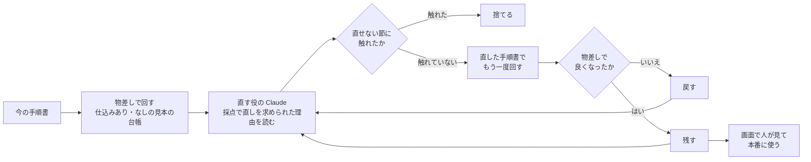

# 分析担当の改善（11/3 に作った）

DX 担当がいなくても、分析担当（Managed Agents の分析エージェント）の手順書（指示文 `agent/analyst_system.md`）が良くなっていく仕組み。
**答えの分かっている台帳で確かめながら直し、良くなった時だけ残す。本番に使うかは人が決める。**

## 流れ



1. **物差し**（`app/improve.py` の `evaluate`）：仕込みあり・なしの見本の台帳を作業用の場所に作り、手順書を差し替えたセッションを並べて回す。本番の台帳・本番のエージェントの版には触らない（セッションの `agent_with_overrides.system` で差し替える）
   - 数えるもの：報告の形が合うか・検算が一致したか・採点の何回目で合格したか・費用
   - 中身の確かめ（`agent/judge.md`・Sonnet 5.5）：仕込みありで「チラシが低く見えるのは先の日の予約が多いから」を見つけたか／仕込みなしで無い差をでっち上げなかったか
2. **直す役**（`propose`・Opus 5.5）：今の手順書・採点で直しを求められた理由・物差しの結果・これまでの回（戻した理由）を読み、1〜3か所の直しを出す。店長向けの「ひとことで言うと」と、直す節ごとの「なぜ・報告で変わる見込み」も書く
3. **直せない節**（`LOCKED`）：「数え方」（アプリの数字と合わせる）・「言わないこと」（言い過ぎを防ぐ）・「出力」（報告の約束）。触れた案はコードで捨て、物差しにお金を使う前に止める
4. **残す・戻す**（`decide`）：直す役の言い分では決めない。報告の形が崩れたら戻す。中身の確かめに落ちたら戻す。採点の回数（2つの台帳の合計）が減ったら残す。同じなら、費用が1割以上減った時だけ残す
5. **次の回**：残した版から直す。戻した回の理由も直す役に渡す（同じ失敗をくり返さない）
6. **本番に使う**：画面「ナットクの改善」（`/improve`）で人が押す。手順書のファイルを書き換え、`scripts/setup_agent.py` と同じ手順でエージェントの版を上げる（失敗したらファイルも戻す）。手順書は git の差分として残るので、コミットするかも人が決める

## 直す役から変えられないもの

- 採点の基準（`agent/rubric.md`）・中身の確かめ（`agent/judge.md`）・残す／戻すの決まり（コード）
- 変えられると、採点を甘くして「良くなった」ことにできてしまうため

## 現場が分からないまま進まないように（画面の見せ方）

- **図**：分析担当の仕事の流れ（役目 → 受け取る台帳 → 数え方 → 調べる順番 → 集計のしかた → 言わないこと → 書く量 → 報告の形 → 質問への答え方）を箱で並べ、直す節に色、直せない節に鍵を付ける
- **ひとことで言うと**：たとえを使った1〜2文（直す役が書く）
- **直す節ごと**：何を直すか・なぜ（採点のどの指摘に当たるか）・報告で変わる見込み（見込みであって、確かめた結果ではないと明記）
- **物差し（前 → 後）**：採点の回数・中身の確かめの ○×・費用。ここが確かめた結果
- **本当の差分**：節ごと・行ごとの足した／消した。差分があるのに説明が無い節は「説明の無い変更」として赤で出す

## 回し方

```sh
uv run python scripts/improve_analyst.py --iterations 2 --reuse-plant agent/sample_run.json
```

鍵が要る。1回の直しで本物の分析が2回（$2 前後・並べて回すので5〜7分）。`--reuse-plant` は、今の版の「仕込みあり」の点数を前に回した分析から取り、1回分を省く。

## まだしていないこと

- 決まった時刻に自動で回す（今は人がコマンドで回す）
- 店の道具の改修の提案（分析が何度も出す「台帳に無いので確かめられない」を、図つきの改修の提案にする）：11/7 の午前
